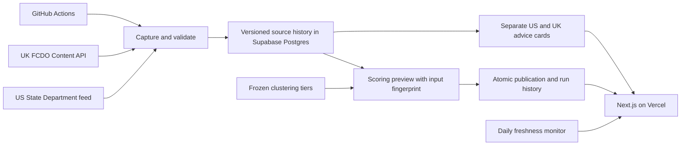

# SafeTrip IQ

Travel-advice explorer combining official US and UK guidance with a transparent, versioned country index. Built with Next.js/TypeScript, Python, PostgreSQL, Docker and GitHub Actions.

**[Live website](https://safetripiq.vercel.app/)** · [Repository guide](docs/repository-guide.md) · [Operations and recovery](docs/operations.md) · [Documentation index](docs/README.md)

## Architecture



The ingestion writer can append advisory history but cannot edit scores. A separate publisher can update only approved output columns; it cannot edit BERT predictions or clustering tiers. The website uses read-only accounts. PostgreSQL RLS, grants, TLS verification and private schemas keep those capabilities separate.

Captured responses have checksums. Documents, content/parser versions and retrieval observations have separate identities, so unchanged content is reused without losing freshness history. ISO3 links advisories to map/catalogue entries; regional and unresolved compound destinations retain explicit coverage.

Publication recomputes the preview and compares its fingerprint with a fresh database snapshot. It commits outputs, provenance and successful run status together, or rolls them back. Source import and score publication are separate transactions: newer advice cards can coexist with previous scores if publication fails.

## Scoring and ML

Production formula: `us-official-cluster-v1`.

| Component | Conversion to displayed 0–10 scale |
| --- | --- |
| Official US level 1, 2, 3, 4 | 10, 7.5, 5, 2.5 |
| Existing clustering risk tier 0, 1, 2, 3, 4 | 10, 8, 6, 4, 2 |

Average the available components equally. One available component is used alone; neither produces a blank score. Regional-only US advice is excluded from the national component and shown separately. Conflicting whole-country levels block publication. UK flags and affected-area excerpts remain separate guidance. Level 4 is explicitly flagged even if the composite is higher.

This index is **not a probability of harm or a government-issued rating**. Frozen clustering tiers use historical index features; data age and original tier ordering limit interpretation. BERT/NLP training and evaluation remain under `research/` and do not contribute to production scores. Model promotion needs an independent evaluation set and a verified label/cleaning audit. See [the scoring contract](docs/official-us-scoring.md).

## Run locally

Prerequisites: Git, Docker Desktop/Compose, Node.js 22 and standalone [uv](https://docs.astral.sh/uv/). Conda and production credentials are unnecessary for the local fixture app.

From the repository root:

```sh
uv python install 3.11
bash scripts/setup_local_db.sh
cd frontend
npm ci
npm run dev:local
```

Open `http://localhost:3000`. The seed has three synthetic development countries, not a production copy. Fixed `*_local_only` passwords apply only to localhost containers. To run the website in Docker, return to the repository root:

```sh
docker compose up -d --build --wait web
```

The containerized site uses port 3001. [Local Docker details](docs/phase-3-local-postgres.md) cover migrations, volumes and shutdown. Local Alembic migrations target an empty development database; hosted Supabase uses reviewed additive scripts in `db/hosted/`.

To normalize fixture advisories without a model or database, from the repository root:

```sh
UV_PROJECT_ENVIRONMENT=.local/advisory-refresh-venv uv sync \
  --frozen --only-group advisory-refresh --no-install-project --python 3.11
PYTHONPATH=pipeline/src .local/advisory-refresh-venv/bin/python -m safetrip.cli \
  ingest-advisories --input tests/fixtures/us_uk_capture.json \
  --output .local/demo/advisory-preview.json
```

Use a fresh output filename on repeat runs. This performs no database writes. Full `uv sync --frozen` retains ML dependencies for historical experiments; the production refresh installs only the small `advisory-refresh` group.

## Deployment and operations

- **Vercel:** `frontend/` is the deployment root; the website stays on Vercel.
- **Supabase:** PostgreSQL stores catalogue/scores and private advisory/run history. Public anon access is read-only; dedicated accounts handle backend operations.
- **GitHub Actions:** CI verifies PRs and main. Refresh supports manual runs and a guarded weekly schedule; a separate daily monitor checks retrieval and publication freshness. See [activation, alerts and recovery](docs/operations.md).
- **AWS:** Terraform/ECR/Fargate/S3 foundations and measured CPU benchmarks remain as a separate cloud lab. They do not execute the V2 refresh.

Keep `.env`, `.local/`, connection configuration and Terraform state private. Never put privileged credentials in `NEXT_PUBLIC_*`, logs or Git. [Hosted setup](docs/hosted-advisory-rollout.md) and [Actions secrets](docs/advisory-refresh-actions.md) explain the restricted accounts. Vercel never receives the publisher secret.

## Verification

```sh
bash scripts/check_ci.sh          # Python baseline and frontend checks
bash scripts/check_database.sh    # Real local PostgreSQL, permissions and recovery
bash scripts/check_containers.sh  # Container build/runtime smoke checks
```

GitHub also exercises Chromium map/search behavior. The frozen regression reproduces 212 historical scores; that verifies refactoring, not predictive accuracy. See [V2 verification](docs/v2-verification.md) for measured evidence and limitations.

The November 2026 scoring rollout covered 250 destinations: 215 numeric scores and 35 blanks. Canada/Japan showed 10.0; USA used clustering alone at 6.0. Palestine/BES retained regional warnings without an unsupported national score. These are snapshot counts and can change with sources.

`frontend/` serves the website; `pipeline/src/safetrip/` contains ingestion/scoring/persistence; `db/` contains migrations/operator tools; `scripts/` contains operations; `research/` holds experiments and archived preparation; `data/baseline/` holds frozen regression inputs. Older phase walkthroughs preserve implementation history; use the current [operations guide](docs/operations.md) for production.
