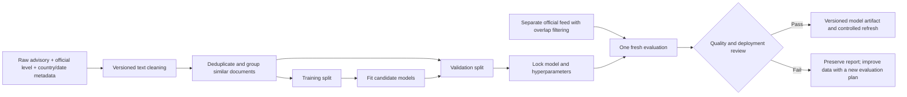

# Clean-text model investigation

Follow-up: [label-transfer-audit.md](label-transfer-audit.md) checks the COVID hypothesis and source labels. Logistic regression performed well on historical non-COVID validation too; COVID absence alone does not explain the transfer failure. The immediate production path is [official-advisory-production-plan.md](official-advisory-production-plan.md), independent of further ML research.

Research outputs live in ignored `.local/research/bert/`. These experiments do not authorize model promotion or a production refresh.

## Why the original result was misleading

The frozen CSVs contain 1,609 rows but only 998 distinct texts after v2 cleaning. The original train/test split shares 136 groups of identical normalized text. Direct advisory recommendations occur in 1,595 original rows. Removing these cues and splitting similar texts together makes the task materially harder and the evaluation more credible.

The original CSVs have no country or publication-date columns. The new split groups near-duplicate texts; it is not a verified country/time split. Three archived government feeds (2019, 2021, 2024) produced no exact cleaned-text matches to the original CSVs. High similarity can guide manual provenance recovery but cannot establish a source date by itself.

## Country identity

`resolve_iso3` in `pipeline/src/safetrip/ingestion/countries.py` formalizes the existing `US_CODE_TO_ISO3` mapping. Government feed tags are a mixture of legacy tags and current two-letter codes. They cannot safely be treated uniformly as ISO alpha-2: legacy `NG` means Niger, while ISO `NG` means Nigeria. The resolver cross-checks names, preserves legacy mappings, and accepts a current ISO mapping only when it matches the named country.

Country identity is retained as metadata for joins and evaluation grouping. It is removed from model input. Regions such as Gaza and West Bank require an explicit aggregation policy before their scores can be published as a single country score. Conflicting same-date feed duplicates also stop publication for review.

## Fixed comparison

Dataset `dataset-v3c` inherits the original similarity-group split, then applies v3 cleaning: 697 training rows, 150 validation rows, and 150 historical test rows. The historical test was already consumed by the first candidate and is not used to select these experiments.

All BERT experiments start from the same cached pretrained `bert-base-uncased`, use seed 42, three epochs, learning rate 2e-5, and effective document batch size 16. Best epoch is selected by validation macro-F1. Fixed padding and gradient checkpointing bound local GPU memory. A previous dynamic-padding attempt is excluded from this comparison; accelerator randomness and changed execution settings can materially affect a small dataset.

| Experiment | Input | Loss weighting |
| --- | --- | --- |
| control256 | First 256 tokens including special tokens | Equal |
| long512 | First 512 tokens | Equal |
| balanced512 | First 512 tokens | Inverse class frequency |
| balanced-tail512 | Beginning and end, total 512 tokens | Inverse class frequency |
| balanced-chunks256 | Whole document in overlapping 256-token windows; mean logits per document | Inverse class frequency |

A separate baseline uses whole-document word/bigram TF-IDF and balanced logistic regression. Only validation selects its regularization parameter from C = 0.1, 1, 10. This tests whether the small dataset benefits from a simpler model before adding BERT complexity.

## Independent feed evaluation

The downloaded official feed contains 223 items. Filtering duplicate cleaned text and exact/near matches to all historical splits leaves 179 documents across 172 country codes and 168 evaluation groups. Class counts for Levels 1–4 are 57, 72, 26, and 24. Some countries have separate regional/document records; country and near-text groups should be used when estimating uncertainty.

The fresh feed is not used to tune parameters. Each family is selected using historical validation, selection is recorded before fresh predictions, and reports refuse overwrites. This is a new feed evaluation with overlap filtering, not proof that historical training provenance is complete or that every semantic overlap has been eliminated.

```sh
uv run --frozen python -m research.scripts.run_bert_investigation \
  --dataset .local/research/bert/dataset-v3c \
  --output .local/research/bert/investigation-v3c
uv run --frozen python -m research.scripts.evaluate_fresh_bert_holdout
uv run --frozen python -m research.scripts.evaluate_fresh_linear_holdout
```

These commands record the frozen v3 experiment. Retraining it requires the v3 cleaner sources preserved in `dataset-v3c/cleaner-source/` (hash-verified against its manifest); current runtime v4 correctly refuses to retrain against v3 data. Fresh evaluation reads the already-cleaned, immutable v3 inputs directly.

Run evaluation only once per locked selection. Preserve the generated manifests and reports. Reusing fresh results to tune another candidate consumes this holdout and requires a new independent evaluation cohort.

## Known limitations before promotion

A residual-text audit found three training examples with the singular phrase “exercise normal precaution” and country aliases “Republic of Korea” / “ROK”. The version used for this experiment is frozen; these are now fixed in runtime cleaning v4, together with DRC/DPRK aliases. The frozen v3 checkpoints remain research artifacts; a future production candidate must be trained and evaluated with its matching cleaner. None of the 150 validation examples contains that singular recommendation phrase.

The historical corpus contains substantial COVID-era language. CDC severity descriptions may be legitimate risk evidence, but a classifier can over-rely on them when predicting current advisories. Report fresh-feed performance and high-risk recall, not only aggregate historical validation accuracy.

No result in this document establishes readiness for travel-safety decisions. Deployment also requires the worker's model manifest, CPU resource checks, explicit feed duplicate/region handling, and a controlled refresh verification.

## Completed validation results

| Model | Historical validation accuracy | Validation macro-F1 | Validation high-risk underestimation |
| --- | ---: | ---: | ---: |
| BERT control256 | 70.67% | 0.6262 | 39.34% |
| BERT long512 | 76.67% | 0.7311 | 36.07% |
| BERT balanced512 | 70.67% | 0.6695 | 22.95% |
| BERT balanced-tail512 | 71.33% | 0.6614 | 34.43% |
| BERT balanced-chunks256 | 76.00% | 0.7545 | 32.79% |
| Linear baseline, C=10 | 88.67% | 0.8940 | 9.84% |

High-risk underestimation means predicting a lower level than the official label for a Level 3 or 4 document. It includes Level 4 predicted as Level 3. It differs from predicting Level 1/2 for a Level 3/4 document.

The locked linear baseline achieved **73.18% accuracy, 0.6755 macro-F1, and 56% high-risk underestimation on the fresh cohort**. Level 3 recall was 38.46%; Level 4 recall was 50%. This decline is evidence that the strong historical validation result does not transfer reliably to this feed. Its strongest positive Level 4 features include “very high,” “unknown level,” and “has not,” often present in archived COVID-era language. These associations suggest a shortcut worth investigating; feature weights alone do not prove a causal explanation for every error.

**Do not promote the linear baseline based on its historical accuracy.** Its local fit plus fresh inference took about 1.14 seconds on this Mac, which demonstrates low computational cost but does not resolve the model-quality problem.

## How to interpret the pipeline



The official level is the supervised target, not an input feature. ISO3 is the database join key, not an input feature. Macro-F1 averages performance equally across all four levels; accuracy alone can look acceptable while Level 3 recognition is poor. The model's output is an advisory class ID, not a calibrated probability or validated continuous measure of personal safety.

## Corrected preprocessing dataset

`dataset-v4` has been prepared with the original group/split assignments preserved: 697 training, 150 validation, 150 historical test rows. No new cross-split exact duplicates or empty rows were introduced. Preparing this dataset does not reset the consumed status of the historical test or fresh feed. It is ready for a separately planned follow-up; no v4 checkpoint is approved.

```sh
uv run --frozen python -m research.scripts.prepare_bert_ablation_data \
  --output .local/research/bert/dataset-v4
```

The command refuses an existing directory. The `source_rows_changed_by_v3` field is a legacy report key counting changes versus the parent v2 dataset, even for the v4 output.

A simple text audit found COVID/coronavirus mentions in 262/697 training documents (37.6%), 47/150 validation documents (31.3%), and 0/179 fresh evaluation documents. This is direct evidence of a text-distribution difference, not proof that every prediction error is caused by COVID-related features.

## Next dataset iteration

1. Preserve each raw feed snapshot with its retrieval timestamp, source URL, content hash, original title/level, country/region identity, and publication date. Do not infer an authoritative date from text similarity.
2. Resolve duplicate and regional records explicitly. Retain historical versions for research rather than letting one silently overwrite another.
3. Audit v4 cleaned text for residual direct labels and country aliases; preserve substantive restrictions, conflict, crime, and health evidence. Review a sample from every level.
4. Include recent non-COVID advisories and enough distinct Level 3/4 examples. Repeated copies of the same advisory do not add independent evidence.
5. Define validation and a new final evaluation period before tuning. Keep related country/document versions grouped, quantify overlap, and avoid recycling today's consumed fresh evaluation as a new test.
6. Compare the simple full-text baseline, BERT, and an ordinal objective using macro-F1 and high-risk error rates. Repeat promising training settings across seeds before claiming a reliable improvement.
7. Promote only a matching cleaner/checkpoint pair that meets explicit quality criteria, then rerun CPU memory/startup benchmarks and a controlled publication check.

The current classifier learns to predict government advisory levels. Its class ID should not be described as an independently validated measure of travel safety. Any conversion to the application's 0–10 display scale remains a separate, documented scoring rule.

The fixed five-run BERT comparison completed successfully. Validation selected `balanced-chunks256`, epoch 3, before fresh prediction. Its Level 3 recall was 40.63% and Level 4 recall 86.21%. The five successful training runs took about 62 minutes in total on the local Mac GPU; this excludes earlier aborted attempts and data analysis. A single seed per configuration supports an exploratory comparison, not a claim of stable superiority across retraining runs.

## Fresh evaluation result and decision

| Model | Accuracy | Macro-F1 | Level 3 recall | Level 4 recall | High-risk underestimated | High-risk predicted Level 1/2 |
| --- | ---: | ---: | ---: | ---: | ---: | ---: |
| BERT control256 | 63.13% | 0.5345 | 7.69% | 83.33% | 36% | 34% |
| Validation-selected full-document BERT | 65.36% | 0.6044 | 34.62% | 62.50% | 42% | 24% |
| Validation-selected linear baseline | 73.18% | 0.6755 | 38.46% | 50.00% | 56% | 44% |

All models evaluated the same 179 documents. The denominator for high-risk rates is 50 Level 3/4 documents. Full-document BERT reduced Level 3/4 predictions of Level 1/2 to 12/50, but also predicted Level 3 for 9 of 24 Level 4 examples; total underestimation was 21/50. This illustrates why accuracy alone is insufficient.

A paired bootstrap over 168 country/near-text groups (2,000 draws, seed 42) estimated the 95% percentile interval for full-document BERT minus control macro-F1 as -0.025 to +0.166. It includes zero: the observed improvement is not convincing evidence of a stable advantage on this small cohort. The corresponding interval versus the linear model was -0.158 to +0.011. These intervals do not account for unknown historical provenance, systematic label issues, or future domain shifts.

CPU loading plus inference took 24.5 seconds for the control and 43.5 seconds for full-document BERT on this Mac using two PyTorch threads. Linear fitting plus inference took 1.14 seconds. These are local observations, not AWS latency, peak-memory, or cost measurements.

**Decision: do not promote any evaluated candidate.** The investigation supports improving dated, representative training data before further architecture tuning. V4 fixes known cleaning gaps and has a prepared dataset, but changing a few aliases does not address the demonstrated temporal distribution shift. A future v4 training/evaluation run needs a fresh evaluation plan; today's holdout is consumed.

Verification: 63 unit tests and 30 local Postgres integration tests passed. The frozen baseline was previously verified with its model and captured outputs after the shared inference encoder change. Generated datasets and model weights are ignored by Git. No AWS model upload, production database publication, or schedule activation was performed.
