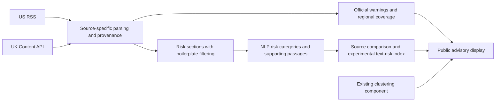

# UK travel advice integration investigation — October 13, 2026

## Finding

GOV.UK offers an official, unauthenticated Content API that returns FCDO travel advice as JSON. UK advice is a feasible second text source for SafeTrip IQ. It does not, by itself, validate a combined NLP safety score or fix the US model's transfer failure.

Official references:

- [Content API overview](https://content-api.publishing.service.gov.uk/): public access, no authentication, documented limit of 10 requests per second per client, beta status, and historical-content limitations.
- [API reference](https://content-api.publishing.service.gov.uk/reference.html): the page path determines the JSON endpoint.
- [Travel-advice schema](https://docs.publishing.service.gov.uk/content-schemas/travel_advice.html): warning flags, country metadata, sections, update/review fields, and change history.
- [FCDO advice policy](https://www.gov.uk/guidance/about-foreign-commonwealth-development-office-travel-advice): advice for British nationals, distinction between all travel and all but essential travel, and whole-country versus regional coverage.
- [Reuse conditions](https://www.gov.uk/help/reuse-govuk-content): Open Government Licence conditions apply; retain attribution and source links.

## Live read-only verification

Six unauthenticated GET requests succeeded: the destination index, France, Thailand, Afghanistan, India, and Ukraine. Local ignored snapshots and a timestamped/hash-bearing report are saved under `.local/research/uk-api/`. No database, model, production scoring, AWS resource, or schedule was changed.

```sh
curl --fail --silent --show-error \
  https://www.gov.uk/api/content/foreign-travel-advice/thailand
```

Discovery endpoint: `https://www.gov.uk/api/content/foreign-travel-advice`. In the sampled response, `links.children` contained **226 destination records**, with names, canonical page/API paths, and update metadata. This is not a count of sovereign countries.

Country endpoints: `https://www.gov.uk/api/content/foreign-travel-advice/{slug}`. Full documents contain `details.parts` entries with `slug`, `title`, and HTML `body`, including safety/security, health, and regional risks where applicable. Warnings/insurance, entry requirements, and getting-help sections are also available. It is structured JSON, but the section bodies still require HTML-to-text extraction.

Use returned paths rather than constructing slugs from ISO3. A cross-check using the current name resolver matched 211 of 226 destination records. Fifteen need UK-specific aliases or multi-territory treatment. For example, “St Martin and St Barthélemy” and “Cook Islands, Tokelau and Niue” cover multiple ISO identities. Country synonyms can include cities, organisations, or territories and are not authoritative ISO mappings.

### Warning flags observed

| Sample page | `details.alert_status` |
| --- | --- |
| France | Empty array |
| Thailand | `avoid_all_but_essential_travel_to_parts` |
| Afghanistan | `avoid_all_travel_to_whole_country` |
| India | `avoid_all_travel_to_parts` |
| Ukraine | Both `avoid_all_travel_to_parts` and `avoid_all_but_essential_travel_to_parts` |

These are actual API observations at retrieval time, not an exhaustive flag enumeration or immutable current advice. An empty array is not a statement that a destination is safe. A regional flag does not apply automatically to every part of a country. Preserve raw values and geography; unknown future values require explicit handling. Do not convert UK statuses directly into US Levels 1–4.

### Updates and history

Sample responses provided `public_updated_at`, `details.updated_at`, `details.reviewed_at`, `change_description`, and timestamped `change_history`. Update notes included changes to visas and entry rules as well as risk changes. Dates sometimes differed: France had an August public update/review date and an October `details.updated_at` value. The index's own public update was in 2024 despite children changing in 2026.

Do not use the parent-index timestamp as the freshness date for every destination, or assume every update changes risk. Save destination metadata and hash the actual selected section bodies; fetch changed documents and avoid rerunning NLP for unrelated text edits. HTTP responses also returned ETags. Conditional-fetch behavior was not tested.

`change_history` provides dated notes, not complete historical document bodies. For a dated training corpus, preserve raw snapshots going forward; obtain and verify archived bodies separately if needed. No historical label/body dataset was created by this investigation.

## Proposed architecture

Keep official warning metadata and NLP analysis as distinct outputs within one source-versioned advisory record:



This gives NLP a task that benefits from both sources: identify risk types, affected places, and supporting passages; compare where the advisories agree or differ. A country may receive evidence about kidnapping from one source and health-system constraints from another.

For a research score, start with category/severity outputs backed by passages and a documented aggregation rule. Keep each source result visible. Account for date, affected region, nationality-specific guidance, source disagreement, and duplicate evidence. Two governments repeating a warning are not independent measurements of incident probability. Model confidence is not a probability that a traveller will be harmed. A mean of text scores or a count of negative words is not a validated travel-safety measure.

Existing US advisory-level BERT weights have not been validated on UK text. Do not concatenate both documents and feed them into that classifier: it has the wrong label system, a demonstrated transfer problem, and limited input length. If predicting UK warning flags, treat that as a separate task and remove explicit recommendation cues from its input.

The existing US cleaner is not automatically appropriate for UK advice. Its boilerplate rules are US-specific; UK regions, consular context, and headings require audit. For risk extraction, retain supporting passages in raw/sanitized form with source offsets and links. Any anonymized model input must remain traceable to its evidence.

## Smallest useful next experiment

1. Build a read-only UK adapter and explicit slug-to-country/region mappings. Persist complete raw JSON, stable content IDs, source timestamps, selected section hashes, and warning flags independently of NLP.
2. Compare US and UK sections for a small, deliberately varied set of destinations. Audit length, duplication, boilerplate, regional scope, and dates before changing the cleaner.
3. Manually label paragraph-level risk categories and evidence spans using one rubric across both sources. Suggested categories include crime, terrorism, kidnapping, armed conflict/unrest, health, and natural hazards; define severity separately from mere mention.
4. Run a cheap rules/TF-IDF baseline before retraining BERT. Group related US/UK records and revisions of the same country in the same split so one source does not leak the other into validation.
5. Fix a new, independently annotated evaluation cohort and promotion criteria before tuning. Report category precision/recall, high-severity misses, evidence extraction, source-specific results, and regional scope mistakes. The previously consumed US feed remains consumed.
6. Consider an experimental combined text-risk index only after evidence extraction works; label it as an application-derived index. Production official advisories and clustering can proceed while this research is evaluated.

## Operations and cost implications

Use low-rate requests, timeouts, bounded retries, caching, and source snapshot hashes. The verified Content API path requires no API key, paid model service, or additional always-on server. A weekly job can discover destination updates then retrieve the needed documents. The documentation does not establish an SLA or a complete historical-content service. UK-specific collection increases HTTP requests and stored data; AWS storage/network/compute are still subject to normal charges. No UK ingestion runtime or cost benchmark has been performed.

Recommendation: add UK advice as a second structured source and develop source-comparison/risk extraction as the NLP feature. Preserve an experimental combined score until a new independent evaluation demonstrates that its underlying evidence and aggregation are reliable.
